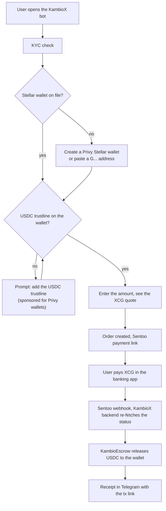
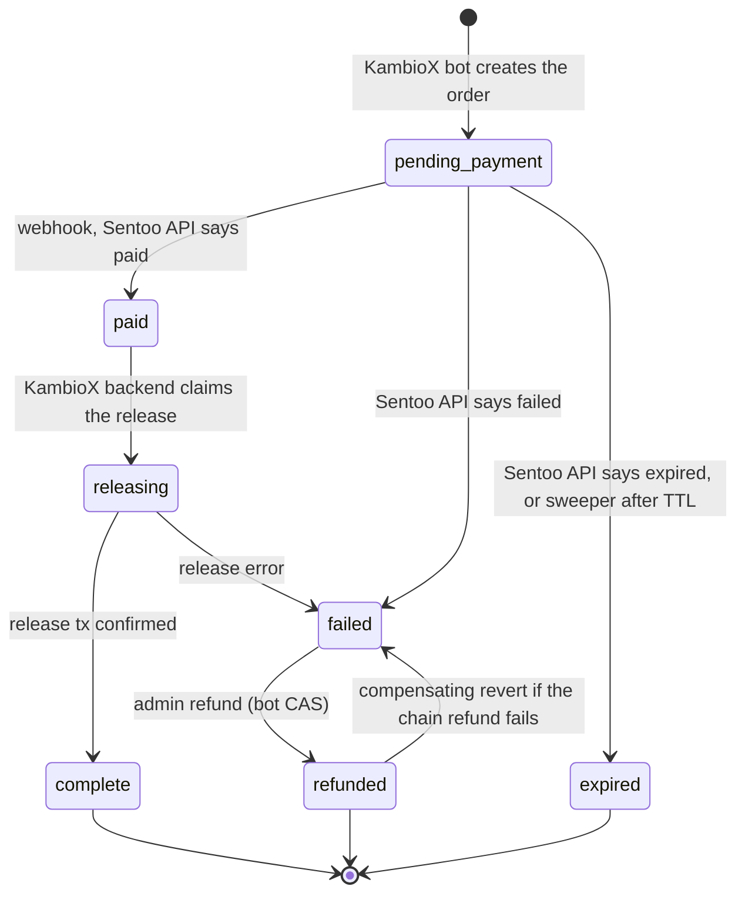
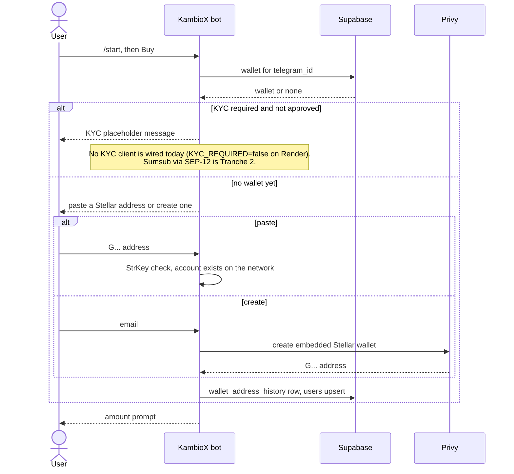
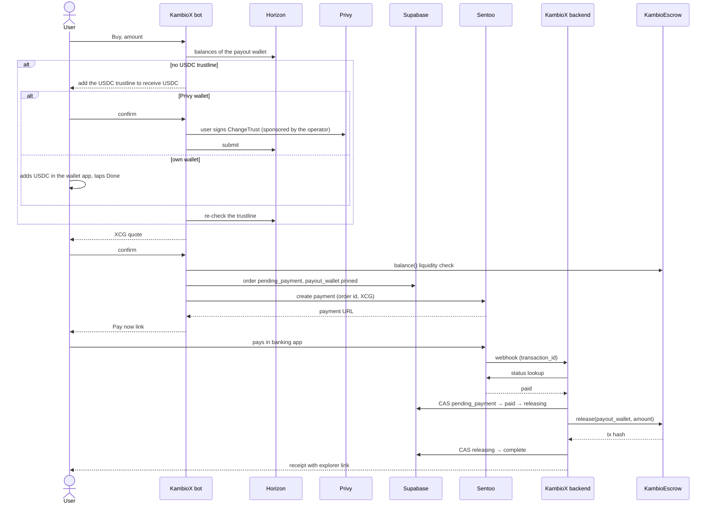
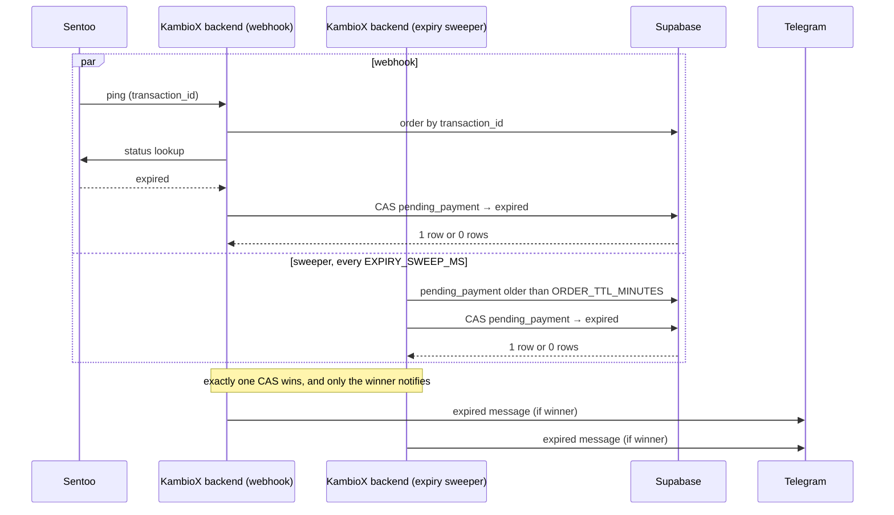
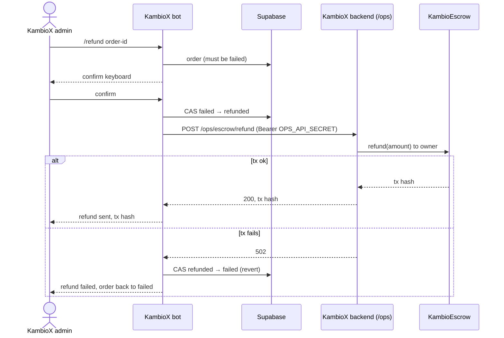
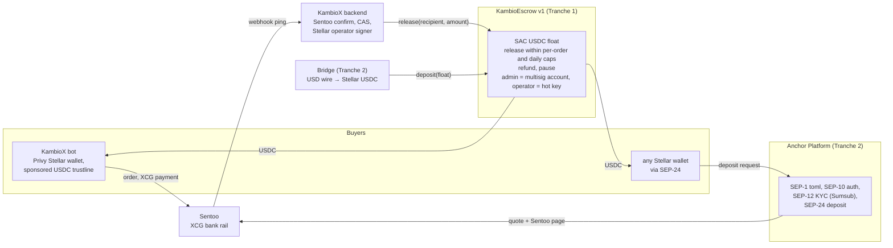
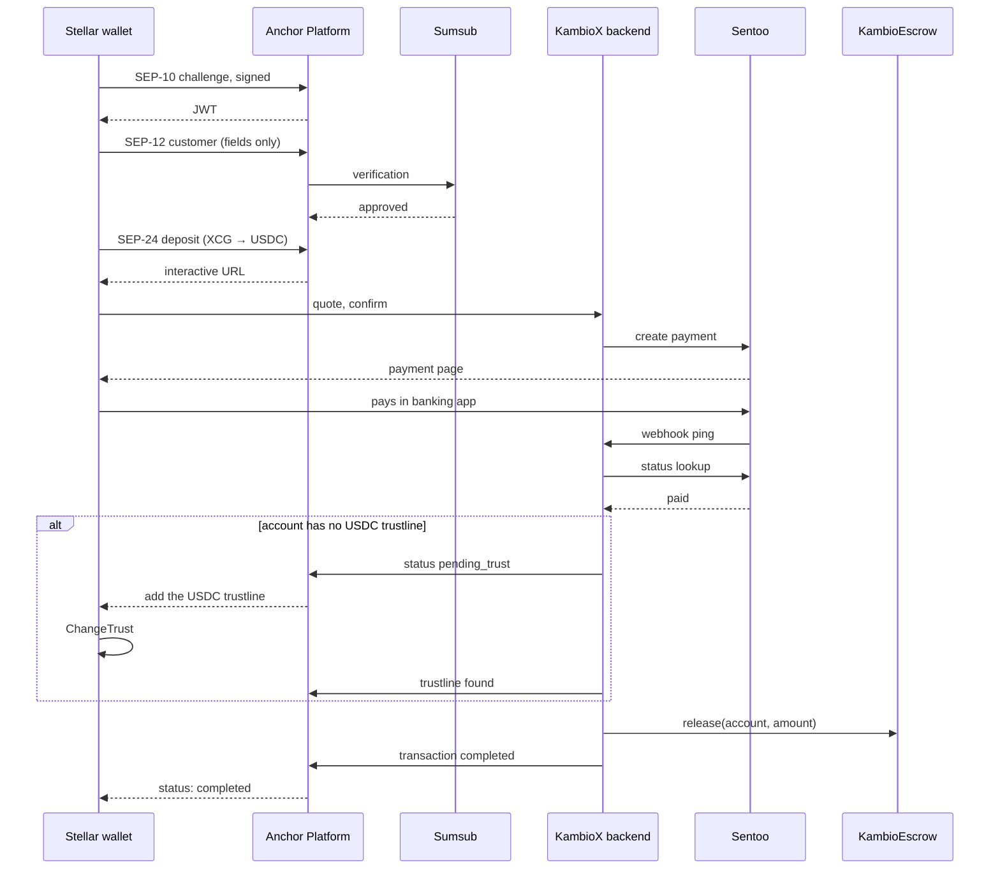

# KambioX architecture

KambioX is an XCG (Caribbean guilder) to USDC on-ramp for Curaçao. People pay from
their bank account through Sentoo and receive USDC from a pooled escrow. This
document describes the system as it runs today (Telegram bot, Sentoo sandbox, EVM
escrow on testnets plus a capped mainnet canary) and the Stellar rebuild that this
directory holds (KambioEscrow, Soroban). On Stellar an account can only hold USDC after it
adds a trustline for the asset, so every deposit flow checks the trustline before any XCG
is taken.

## 1. Overview

What happens, in order, when someone buys USDC with XCG.

Live today: the Sentoo payment, the order state machine and the escrow release (on EVM).
Tranche 1 of the SCF Build moves the wallet, trustline and release steps to Stellar.

## 2. Order lifecycle

Every status change is a compare-and-set update (`UPDATE … WHERE id = ? AND status = from`),
and a trigger appends each change to `order_status_events`. Only the winning CAS acts or
notifies, which is what makes the payment/expiry race safe.

Notes: `paid → failed` is legal in the map but no code path takes it today. `refunded → failed`
is a compensating update made by the bot outside the map. The release tx hash is sent to the
user and logged; it is not stored on the order yet (Tranche 1 adds `chain` and `release_tx_hash`).

Verified against: `apps/backend/domain/orderStatus.js:21-32`, `apps/backend/services/orders.js:74-84`,
`apps/bot/services/operator.js:114-133`, `supabase/migrations/0002_order_status_events.sql`.

## 3. Workflows

### 3.1 Onboarding and wallet

### 3.2 Deposit: XCG in, USDC out

The escrow release is a Stellar Asset Contract transfer, which fails if the recipient has no
USDC trustline. So the KambioX bot checks the trustline first and, if it is missing, prompts the user
to add it before showing the quote. For Privy wallets the operator account sponsors the
reserve, so the user needs no XLM.

### 3.3 Payment failure and the expiry race

The webhook body is treated as an unauthenticated ping. Status comes only from the Sentoo API,
and the fetch happens only while the order is still `pending_payment`, which keeps the handler
under Sentoo's per-transaction lookup limit and makes duplicate or out-of-order webhooks harmless.

Acknowledgement rules: handled, duplicate, unknown-transaction and refund webhooks get 200;
missing `transaction_id` gets 400; an unexpected internal error returns 500 so Sentoo retries.
A Telegram failure never aborts or rolls back the money flow.

### 3.4 Admin refund

The on-chain refund returns pooled USDC to the operator treasury (the escrow owner), not to the
buyer. Any fiat refund to the buyer is handled outside the system.

## 4. Stellar target (SCF Build scope)

Nothing in this section is live. It shows where each grant deliverable plugs in.

### 4.1 SEP-24 deposit from a third-party wallet (PLANNED)

## 5. SCF Build tranches

Deliverables for the Integration Track submission (Anchor Platform, Bridge, Privy). SCF pays
10% on acceptance, then 20% / 30% / 40% against tranches 1 to 3; each tranche form is due
within 90 days of the previous payment, and the project runs at most 6 months. The shares
below are of each tranche, so the sheet can be filled from them. Audit, legal and entity costs
are outside the budget by SCF rules (the audit goes through the SCF Audit Bank).

### Tranche 1, MVP, months 1-2 (20% of the award)

"KambioEscrow v1 and the bot on Stellar testnet."

| ID | Deliverable | Stellar component | Evidence | Share of T1 |
|---|---|---|---|---|
| 1.1 | KambioEscrow v1 on testnet: `release`, per-order `refund`, per-order cap, daily cap, `pause`/`unpause`, admin rotation. Roles: `admin` = multisig account (protocol-enforced signer weights) for pause, caps, withdraw and rotation; `operator` = hot key for `release` within caps. Event on every state change, ≥ 90% line coverage, attested release, StellarExpert-verified | Soroban, Stellar Asset Contract (USDC) | contract ID, release tag, CI run, explorer link | 50% |
| 1.2 | Backend Stellar release path: `stellar-testnet` in `packages/chains`, Stellar signer adapter in the backend escrow service, migration adding `orders.chain` and `orders.release_tx_hash`, explorer links in notifications | Soroban RPC, operator account | Sentoo sandbox payment → USDC in a Stellar testnet wallet, tx hash, recorded demo | 25% |
| 1.3 | Privy Stellar wallets in the bot with a sponsored USDC trustline (sponsor account, sponsored reserves, change trust) | Privy (Integration List) | new user from `/start` to a funded wallet on testnet | 15% |
| 1.4 | Runbook v2 and this document's Stellar section marked live | docs | merged docs | 10% |

### Tranche 2, Testnet, months 3-4 (30% of the award)

"Any Stellar wallet buys USDC with XCG."

| ID | Deliverable | Stellar component | Evidence | Share of T2 |
|---|---|---|---|---|
| 2.1 | Anchor Platform on testnet: SEP-1 `stellar.toml` on the KambioX domain, SEP-10 auth, SEP-12 KYC through the Sumsub callback, SEP-24 interactive deposit reusing the existing quote and Sentoo page, release to the SEP-10 account | Anchor Platform (Integration List) | SDF anchor validator pass for SEP-1/10/12/24; deposit from a third-party wallet (Lobstr, Beans or Freighter) recorded | 45% |
| 2.2 | Bridge refill: business account, USD wire → Stellar USDC → `deposit` into KambioEscrow; treasury reconciliation job (Bridge transfers vs on-chain deposits); XCG → USD → Bridge runbook | Bridge (Integration List) | sandbox transfer landing in the escrow, reconciliation report | 15% |
| 2.3 | Threat model and monitoring: STRIDE document; alerts on escrow balance vs outstanding orders, daily cap usage, pause state and failed releases; on-chain event ingestion feeding reconciliation; Audit Bank application submitted | Soroban events, RPC | documents in the repo, alert screenshots, Audit Bank confirmation | 25% |
| 2.4 | Narrow user testing in Curaçao: 20-30 testers on testnet through the bot and a SEP-24 wallet, feedback report | bot, Anchor Platform | tester log and report | 15% |

### Tranche 3, Mainnet, months 5-6 (40% of the award)

"Capped mainnet inside the CBCS sandbox."

| ID | Deliverable | Stellar component | Evidence | Share of T3 |
|---|---|---|---|---|
| 3.1 | KambioEscrow on mainnet, attested and verified, admin multisig live, caps at the sandbox figures, pause drill run, audit findings fixed | Soroban mainnet | contract ID, multisig account, drill log | 30% |
| 3.2 | Anchor Platform on mainnet with Circle USDC, Sumsub production KYC | Anchor Platform | `stellar.toml` live, mainnet deposit from a third-party wallet | 25% |
| 3.3 | First production float through Bridge, treasury runbook executed | Bridge | funding transaction into the escrow | 10% |
| 3.4 | Committed on-chain metric (Integration Track gate): at least 100 completed orders and 50 distinct recipient accounts released on mainnet within the tranche window | Soroban mainnet | explorer query over release events | 20% |
| 3.5 | Public docs: SEP-24 integrator guide, final architecture, monitoring dashboards | docs | merged docs, dashboard links | 15% |

Dependency stated up front: tranche 3 needs CBCS sandbox admission. If admission slips past
month 6, the fallback is a team-and-tester-only mainnet canary under caps (as on Base and Arc
today), with the 3.4 metric measured on that canary.

Mapping to the abstract: 1.1 to 1.3 are "Months 1-2", 2.1 to 2.3 are "Months 3-4",
3.1 to 3.4 are "Months 5-6". 2.4 uses the Integration Track allowance for narrow user testing.
