# KambioX architecture

KambioX is an XCG (Caribbean guilder) to USDC on-ramp for Curaçao. People pay from
their bank account through Sentoo and receive USDC from a pooled escrow. This
document describes the system as it runs today (Telegram bot, Sentoo sandbox, EVM
escrow on testnets plus a capped mainnet canary) and the Stellar rebuild that this
directory holds (KambioEscrow, Soroban). Sections marked **PLANNED** are grant scope:
nothing in them is live.

Every section ends with the files it was checked against (paths from the repo root),
so a reader can confirm the diagram still matches the code. Diagrams are Mermaid and
render on GitHub.

Related: [`../../SECURITY.md`](../../SECURITY.md) (safeguards and pre-mainnet gates),
[`../../AGENTS.md`](../../AGENTS.md) (money-path invariants),
[`../../docs/stellar/TESTNET.md`](../../docs/stellar/TESTNET.md) (escrow runbook).

## 1. Scope and posture

- **Live today.** Telegram bot (`t.me/Cura_ramp_bot`), Sentoo sandbox payments, `Escrow.sol`
  on EVM testnets, and a capped mainnet canary on Base and Arc. Testnet and provider-sandbox
  posture: no public launch before CBCS sandbox admission.
- **This directory.** KambioEscrow v0.2.0, the minimal Soroban escrow: `deposit`, owner-only
  `release` and `withdraw`, `balance`, `owner`, `token`. Testnet only. Per-order and daily caps,
  pause, per-order refund and a multisig admin are Tranche 1 of the SCF Build (section 11).
- **Custody model.** Pooled custody with off-chain order accounting. One USDC float serves many
  small orders; the contract has no per-order ledger. Orders, limits and reconciliation live in
  Postgres.
- **Not done, and not claimed.** Independent escrow audit, multisig or KMS-backed ownership,
  and regulatory review are outstanding.

Verified against: `contracts/stellar/escrow/src/lib.rs`, `contracts/stellar/AGENTS.md`,
`MAINNET.md`, `SECURITY.md`.

## 2. System context and data flow

What crosses each boundary. The bot never holds a signing key; the backend never receives
KYC documents; the Supabase service-role key stays server-side.

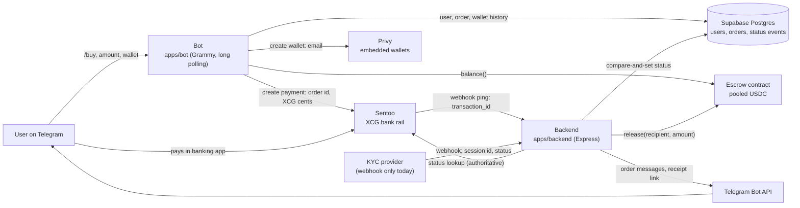

Verified against: `apps/bot/index.js:73-235`, `apps/bot/services/payments.js:117-138`,
`apps/bot/services/privy.js:67-86`, `apps/backend/index.js:15-76`,
`apps/backend/routes/sentoo.js:65-166`, `apps/backend/routes/kyc.js:27-57`,
`apps/backend/services/notifier.js:15-25`.

## 3. Deployment

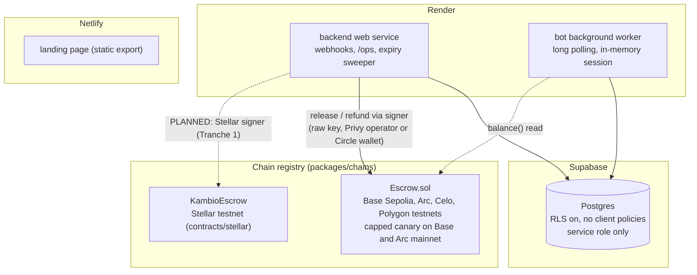

Verified against: `render.yaml`, `netlify.toml`, `packages/chains/chains.js:10-109`,
`apps/backend/services/escrow.js:111-133`, `supabase/migrations/0001_init.sql:66-67`.

## 4. Order pipeline

From amount to USDC in the wallet. The liquidity check runs before any order row or payment
link exists, so a buyer is never charged for USDC the float cannot deliver.

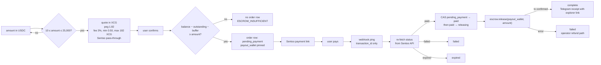

Verified against: `apps/bot/flows/buy.js:16-115`, `apps/bot/lib/fx.js:24-48,135-221`,
`apps/bot/services/payments.js:83-138`, `apps/backend/routes/sentoo.js:84-159`.

## 5. Order lifecycle

Every status change is a compare-and-set update (`UPDATE … WHERE id = ? AND status = from`),
and a trigger appends each change to `order_status_events`. Only the winning CAS acts or
notifies, which is what makes the payment/expiry race safe.

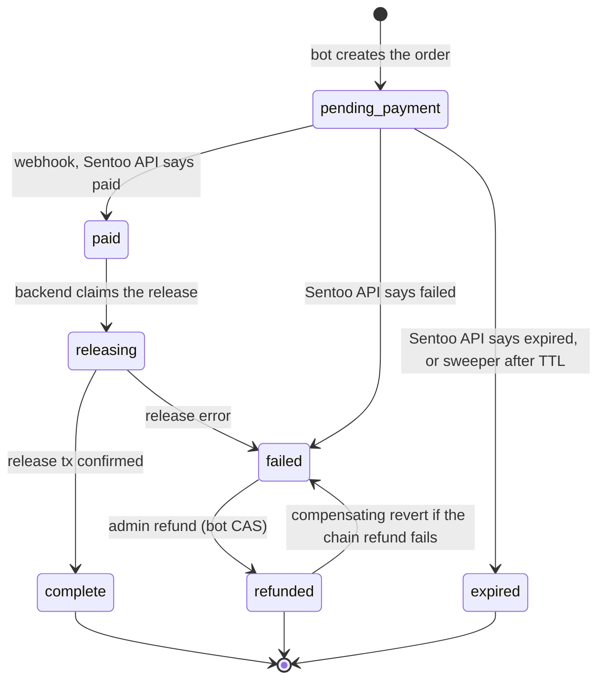

Notes: `paid → failed` is legal in the map but no code path takes it today. `refunded → failed`
is a compensating update made by the bot outside the map. The release tx hash is sent to the
user and logged; it is not stored on the order yet (Tranche 1 adds `chain` and `release_tx_hash`).

Verified against: `apps/backend/domain/orderStatus.js:21-32`, `apps/backend/services/orders.js:74-84`,
`apps/bot/services/operator.js:114-133`, `supabase/migrations/0002_order_status_events.sql`.

## 6. Workflows

### 6.1 Onboarding and wallet

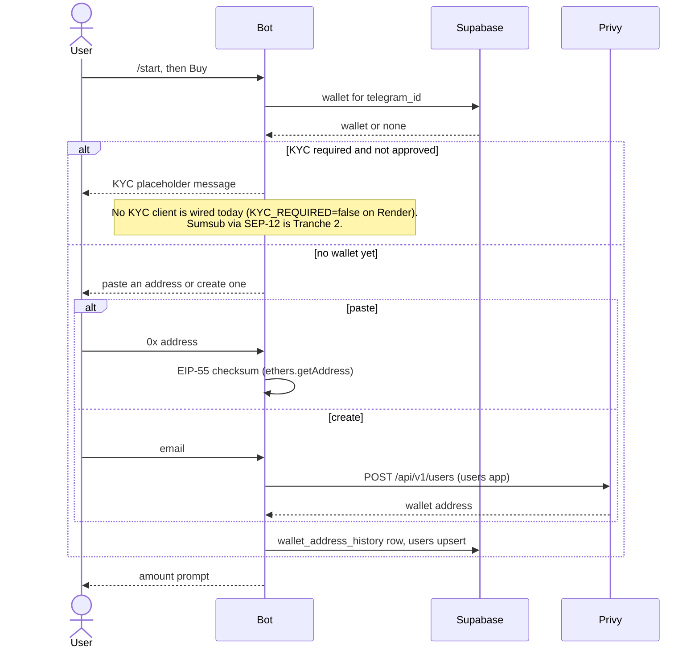

Verified against: `apps/bot/index.js:99-110,171-211`, `apps/bot/flows/kyc.js:14-55`,
`apps/bot/flows/wallet.js:17-127`, `apps/bot/services/users.js:7-37`, `apps/bot/state/session.js:39-47`.

### 6.2 Buy and payout, happy path

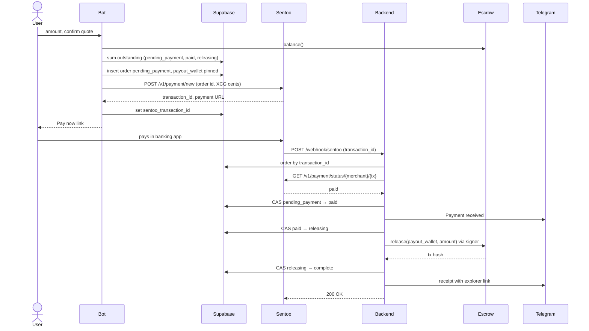

Verified against: `apps/bot/services/payments.js:117-138`, `apps/bot/services/sentoo.js:25-60`,
`apps/backend/routes/sentoo.js:98-159`, `apps/backend/services/sentoo.js:119-130`,
`apps/backend/services/escrow.js:48-91`.

### 6.3 Payment failure and the expiry race

The webhook body is treated as an unauthenticated ping. Status comes only from the Sentoo API,
and the fetch happens only while the order is still `pending_payment`, which keeps the handler
under Sentoo's per-transaction lookup limit and makes duplicate or out-of-order webhooks harmless.

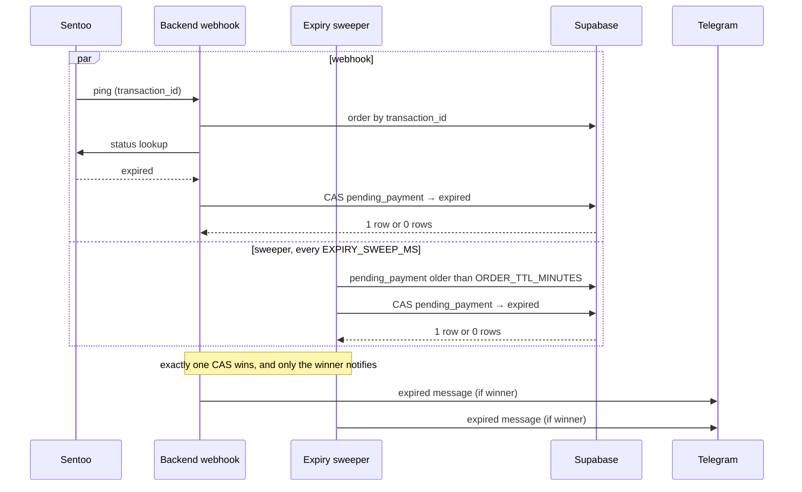

Acknowledgement rules: handled, duplicate, unknown-transaction and refund webhooks get 200;
missing `transaction_id` gets 400; an unexpected internal error returns 500 so Sentoo retries.
A Telegram failure never aborts or rolls back the money flow.

Verified against: `apps/backend/routes/sentoo.js:65-166`, `apps/backend/services/expiry.js:19-71`,
`apps/backend/services/orders.js:86-102`, `docs/solutions/sentoo-webhook-refetch-and-cas.md`.

### 6.4 Admin refund

The on-chain refund returns pooled USDC to the operator treasury (the escrow owner), not to the
buyer. Any fiat refund to the buyer is handled outside the system.

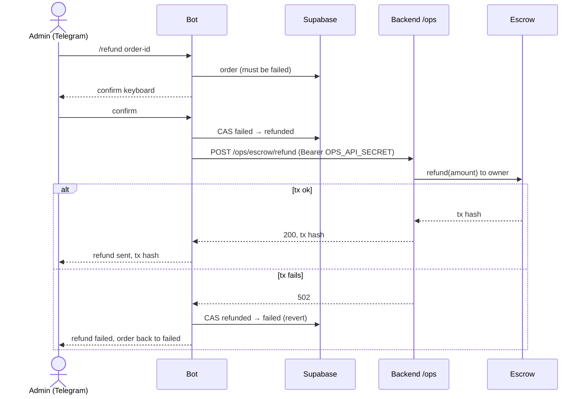

Verified against: `apps/bot/flows/admin.js:80-139`, `apps/bot/services/operator.js:23-33,114-133`,
`apps/backend/routes/ops.js:33-65`, `contracts/evm/src/Escrow.sol:57-63`.

### 6.5 Float funding and access control

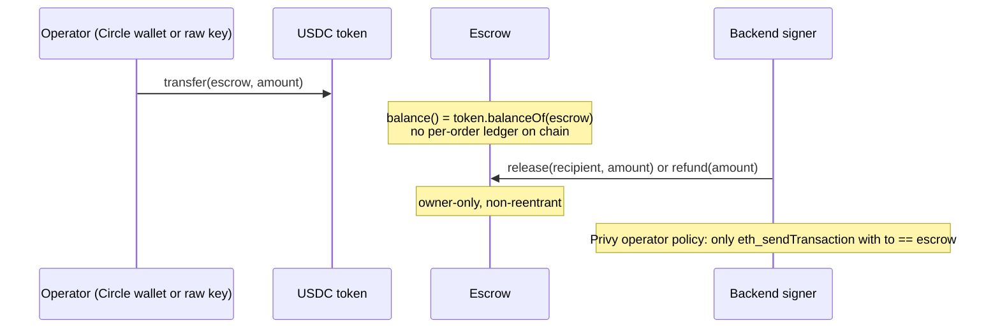

Verified against: `apps/backend/scripts/fund-escrow.js:58-72`, `contracts/evm/src/Escrow.sol:40-68`,
`apps/backend/scripts/setup-operator-policy.js:54-80`.

## 7. Data model

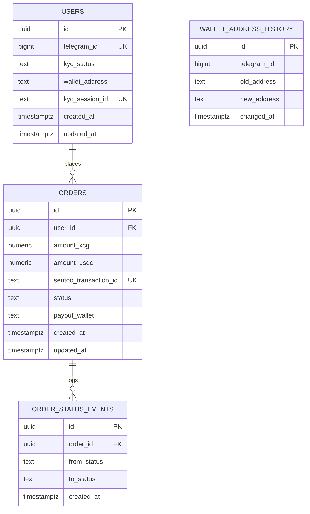

- `orders.status` is a CHECK constraint over `pending_payment, paid, releasing, complete,
  failed, refunded, expired` (no Postgres enum).
- `order_status_events` is filled by an AFTER INSERT/UPDATE trigger whenever the status changes.
- RLS is enabled on every table with no client policies: `anon` and `authenticated` are denied,
  the server-side service role bypasses it.
- `users.kyc_status` and `users.kyc_session_id` are the only KYC data stored. No documents, ever.

Verified against: `supabase/migrations/0001_init.sql`, `0002_order_status_events.sql`,
`0003_users_kyc_session.sql`, `0004_wallet_address_history.sql`, `0005_orders_payout_wallet.sql`.

## 8. Delivery pipeline

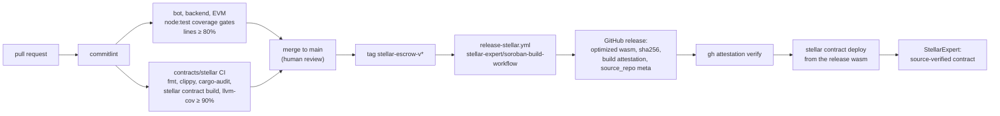

The deployed wasm must be the release artifact: a local `make build` uses a different CLI
version and hashes differently, so it cannot be source-verified.

Verified against: `.github/workflows/ci.yml`, `.github/workflows/contracts-stellar.yml`,
`.github/workflows/release-stellar.yml`, `docs/stellar/TESTNET.md` (section 6).

## 9. Stellar target (PLANNED, SCF Build scope)

Nothing in this section is live. It shows where each grant deliverable plugs in.

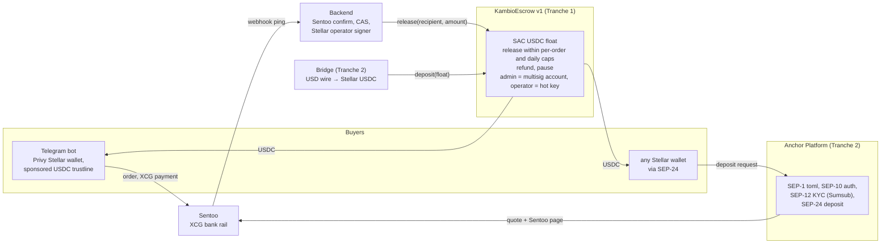

### 9.1 SEP-24 deposit from a third-party wallet (PLANNED)

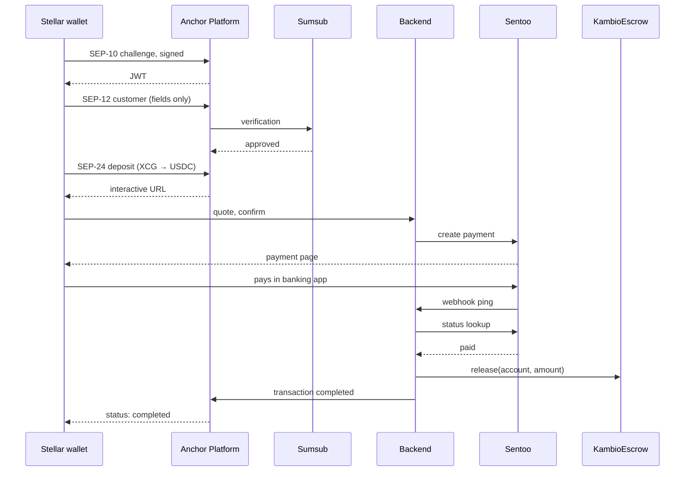

Verified against: the SCF abstract (integration description) and `docs/stellar/TESTNET.md`
(notes for the backend port). No code yet.

## 10. Trust boundaries and invariants

| Boundary | Rule | Where it is enforced |
|---|---|---|
| Sentoo webhook | Body is an unauthenticated ping. Status comes from the Sentoo API only. Optional URL token compared in constant time | `apps/backend/routes/sentoo.js:18-22,98` |
| Order status | Compare-and-set `tryTransition(id, from, to)`, never an unconditional update | `apps/backend/services/orders.js:74-84` |
| Payout recipient | The wallet pinned in `orders.payout_wallet` at order creation; the user's current wallet only as a legacy fallback | `apps/backend/routes/sentoo.js:140-143` |
| Liquidity | No order row or payment link unless `balance − outstanding − buffer ≥ amount` | `apps/bot/services/payments.js:83-121` |
| Escrow | Pooled custody, owner-only `release`/`refund` (EVM) and `release`/`withdraw` (Stellar) | `contracts/evm/src/Escrow.sol`, `contracts/stellar/escrow/src/lib.rs` |
| Signing | Backend only; raw key is testnet-only, Privy or Circle MPC wallet otherwise; policy restricts `to == escrow` | `apps/backend/services/escrow.js:111-133`, `apps/backend/scripts/setup-operator-policy.js` |
| KYC data | Session id and terminal status only; no document endpoints, no document fields in logs or DB | `apps/backend/routes/kyc.js`, `supabase/migrations/0003_users_kyc_session.sql` |
| Database | RLS on, no client policies; service role server-side only | `supabase/migrations/0001_init.sql:66-67` |
| Notifications | Telegram failures never abort or roll back the money flow | `apps/backend/routes/sentoo.js:26-38` |

## 11. SCF Build tranches

Deliverables for the Integration Track submission (Anchor Platform, Bridge, Privy). SCF pays
10% on acceptance, then 20% / 30% / 40% against tranches 1 to 3; each tranche form is due
within 90 days of the previous payment, and the project runs at most 6 months. The shares
below are of each tranche, so the sheet can be filled from them. Audit, legal and entity costs
are outside the budget by SCF rules (the audit goes through the SCF Audit Bank).

### Tranche 1, MVP, months 1-2 (20% of the award)

"KambioEscrow v1 and the bot on Stellar testnet."

| ID | Deliverable | Stellar component | Evidence | Share of T1 |
|---|---|---|---|---|
| 1.1 | KambioEscrow v1 on testnet: `release`, per-order `refund`, per-order cap, daily cap, `pause`/`unpause`, admin rotation. Roles: `admin` = multisig account (protocol-enforced signer weights) for pause, caps, withdraw and rotation; `operator` = hot key for `release` within caps. Event on every state change, ≥ 90% line coverage, attested release, StellarExpert-verified | Soroban, Stellar Asset Contract (USDC) | contract ID, release tag, CI run, explorer link | 50% |
| 1.2 | Backend Stellar release path: `stellar-testnet` in `packages/chains`, Stellar signer adapter in the backend escrow service, migration adding `orders.chain` and `orders.release_tx_hash`, explorer links in notifications | Soroban RPC, operator account | Sentoo sandbox payment → USDC in a Stellar testnet wallet, tx hash, recorded demo | 25% |
| 1.3 | Privy Stellar wallets in the bot with a sponsored USDC trustline (sponsor account, sponsored reserves, change trust) | Privy (Integration List) | new user from `/start` to a funded wallet on testnet | 15% |
| 1.4 | Runbook v2 and this document's Stellar section marked live | docs | merged docs | 10% |

### Tranche 2, Testnet, months 3-4 (30% of the award)

"Any Stellar wallet buys USDC with XCG."

| ID | Deliverable | Stellar component | Evidence | Share of T2 |
|---|---|---|---|---|
| 2.1 | Anchor Platform on testnet: SEP-1 `stellar.toml` on the KambioX domain, SEP-10 auth, SEP-12 KYC through the Sumsub callback, SEP-24 interactive deposit reusing the existing quote and Sentoo page, release to the SEP-10 account | Anchor Platform (Integration List) | SDF anchor validator pass for SEP-1/10/12/24; deposit from a third-party wallet (Lobstr, Beans or Freighter) recorded | 45% |
| 2.2 | Bridge refill: business account, USD wire → Stellar USDC → `deposit` into KambioEscrow; treasury reconciliation job (Bridge transfers vs on-chain deposits); XCG → USD → Bridge runbook | Bridge (Integration List) | sandbox transfer landing in the escrow, reconciliation report | 15% |
| 2.3 | Threat model and monitoring: STRIDE document; alerts on escrow balance vs outstanding orders, daily cap usage, pause state and failed releases; on-chain event ingestion feeding reconciliation; Audit Bank application submitted | Soroban events, RPC | documents in the repo, alert screenshots, Audit Bank confirmation | 25% |
| 2.4 | Narrow user testing in Curaçao: 20-30 testers on testnet through the bot and a SEP-24 wallet, feedback report | bot, Anchor Platform | tester log and report | 15% |

### Tranche 3, Mainnet, months 5-6 (40% of the award)

"Capped mainnet inside the CBCS sandbox."

| ID | Deliverable | Stellar component | Evidence | Share of T3 |
|---|---|---|---|---|
| 3.1 | KambioEscrow on mainnet, attested and verified, admin multisig live, caps at the sandbox figures, pause drill run, audit findings fixed | Soroban mainnet | contract ID, multisig account, drill log | 30% |
| 3.2 | Anchor Platform on mainnet with Circle USDC, Sumsub production KYC | Anchor Platform | `stellar.toml` live, mainnet deposit from a third-party wallet | 25% |
| 3.3 | First production float through Bridge, treasury runbook executed | Bridge | funding transaction into the escrow | 10% |
| 3.4 | Committed on-chain metric (Integration Track gate): at least 100 completed orders and 50 distinct recipient accounts released on mainnet within the tranche window | Soroban mainnet | explorer query over release events | 20% |
| 3.5 | Public docs: SEP-24 integrator guide, final architecture, monitoring dashboards | docs | merged docs, dashboard links | 15% |

Dependency stated up front: tranche 3 needs CBCS sandbox admission. If admission slips past
month 6, the fallback is a team-and-tester-only mainnet canary under caps (as on Base and Arc
today), with the 3.4 metric measured on that canary.

Mapping to the abstract: 1.1 to 1.3 are "Months 1-2", 2.1 to 2.3 are "Months 3-4",
3.1 to 3.4 are "Months 5-6". 2.4 uses the Integration Track allowance for narrow user testing.
