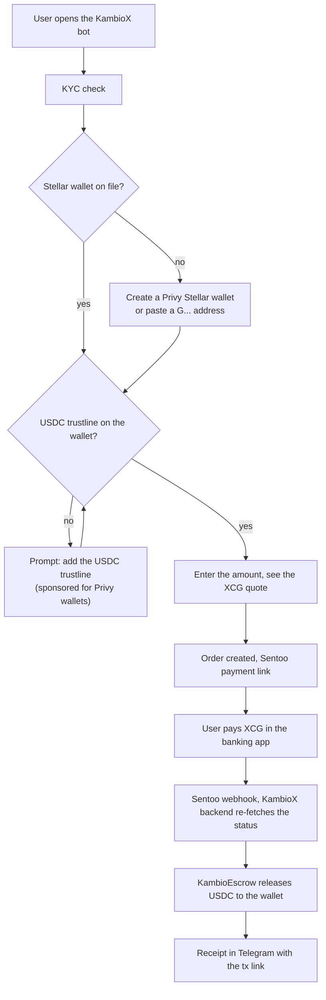
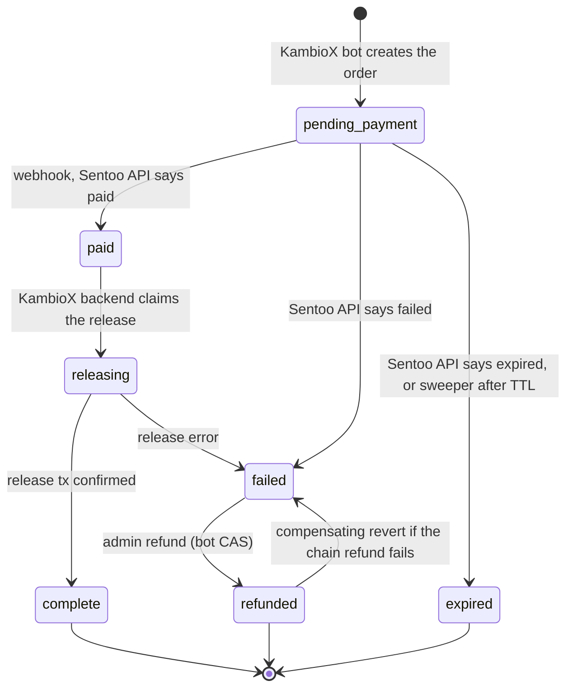
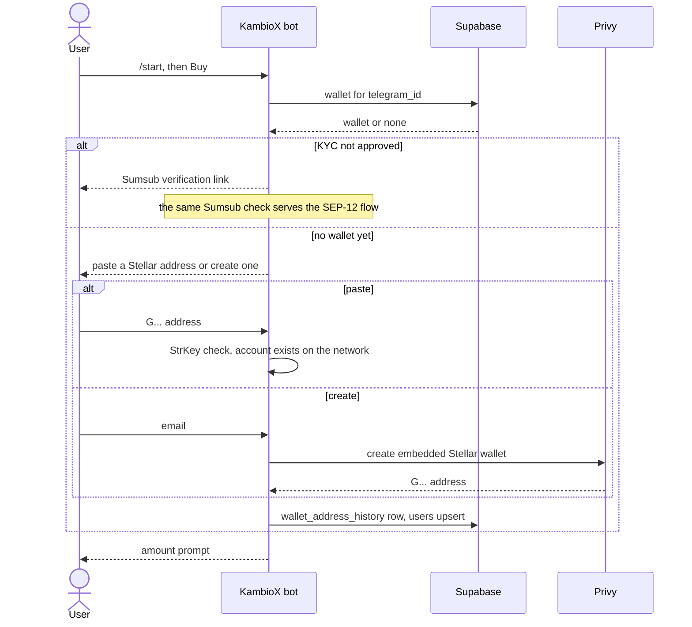
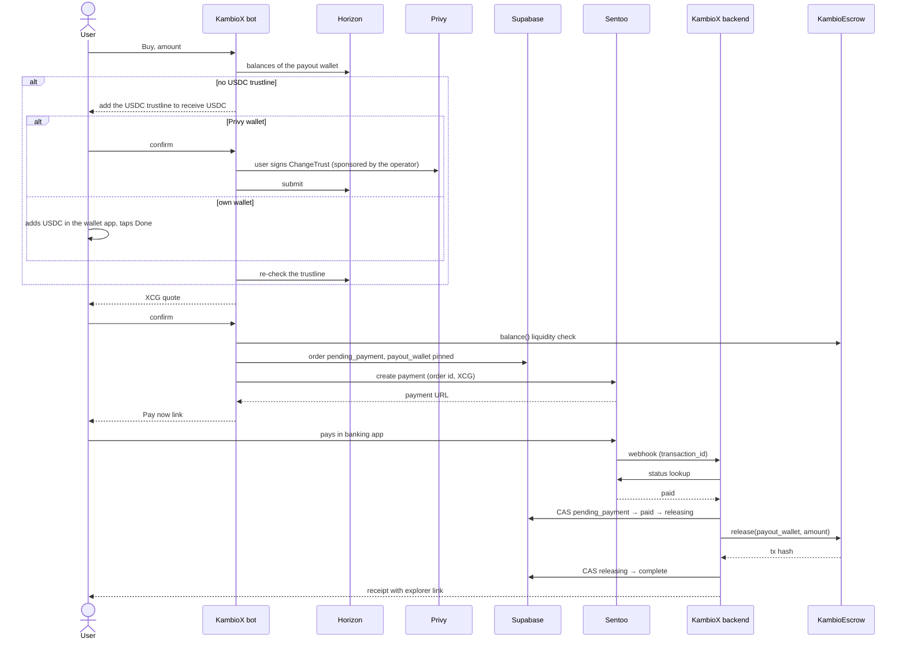
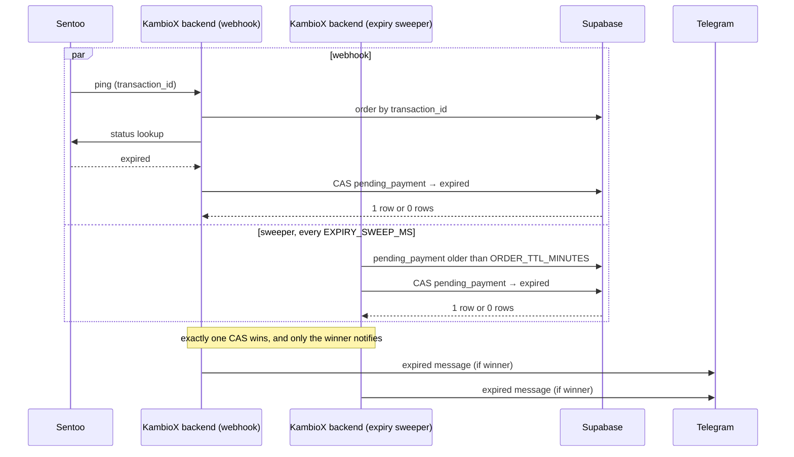
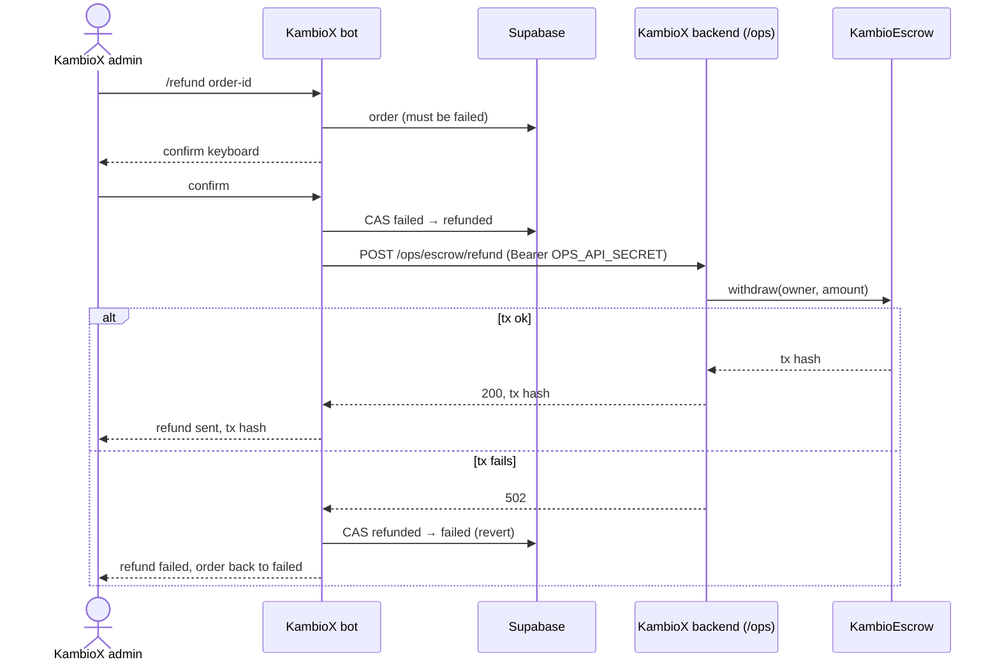
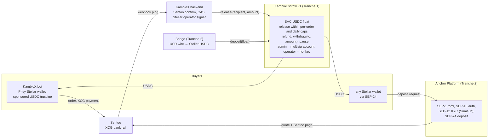
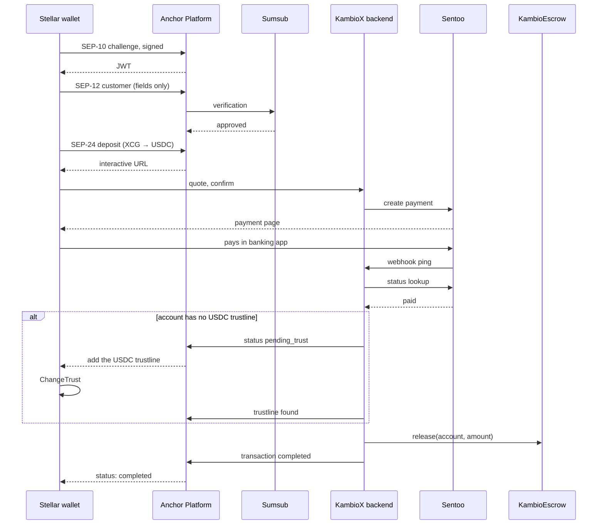

# KambioX architecture

KambioX is an XCG (Caribbean guilder) to USDC on-ramp for Curaçao. People pay from
their bank account through Sentoo and receive USDC on Stellar from KambioEscrow, a
pooled-custody Soroban contract that holds one USDC float for many small orders. This
document describes that system: the KambioX bot on Telegram, the KambioX backend that
confirms payments and releases funds, the escrow in this directory, and the Anchor
Platform integration that lets any Stellar wallet buy USDC with XCG. On Stellar an account
can only hold USDC after it adds a trustline for the asset, so every deposit flow checks the
trustline before any XCG is taken.

## 1. Overview

What happens, in order, when someone buys USDC with XCG.

## 2. Order lifecycle

Every status change is a compare-and-set update (`UPDATE … WHERE id = ? AND status = from`),
and a trigger appends each change to `order_status_events`. Only the winning CAS acts or
notifies, which is what makes the payment/expiry race safe.

The release transaction hash is stored on the order and sent to the user as the receipt.

## 3. Workflows

### 3.1 Onboarding and wallet

### 3.2 Deposit: XCG in, USDC out

The escrow release is a Stellar Asset Contract transfer, which fails if the recipient has no
USDC trustline. So the KambioX bot checks the trustline first and, if it is missing, prompts the user
to add it before showing the quote. For Privy wallets the operator account sponsors the
reserve, so the user needs no XLM.

### 3.3 Payment failure and the expiry race

The webhook body is treated as an unauthenticated ping. Status comes only from the Sentoo API,
and the fetch happens only while the order is still `pending_payment`, which keeps the handler
under Sentoo's per-transaction lookup limit and makes duplicate or out-of-order webhooks harmless.

Acknowledgement rules: handled, duplicate, unknown-transaction and refund webhooks get 200;
missing `transaction_id` gets 400; an unexpected internal error returns 500 so Sentoo retries.
A Telegram failure never aborts or rolls back the money flow.

### 3.4 Admin refund

The on-chain refund returns pooled USDC to the operator treasury (the escrow owner), not to the
buyer. Any fiat refund to the buyer is handled outside the system.

## 4. Components and SCF Build scope

Where each SCF Build deliverable plugs in.

### 4.1 SEP-24 deposit from a third-party wallet

## 5. SCF Build deliverables, hours and costs

This section matches the SCF Build submission field for field. The anchor also serves SEP-38 firm quotes and SEP-6 programmatic deposits in tranche 3, on the same SEP-10 auth, SEP-12 KYC and KambioEscrow release path shown above.

Rates: Fernando Trouw USD 100/h, Ruben Russel USD 80/h.

| # | Deliverable | Owner | Hours | Cost (USD) |
|---|---|---|---|---|
| 1.1 | KambioEscrow v1 | Fernando 120 | 120 | 12,000 |
| 1.2 | Stellar settlement path in the backend | Ruben 80 | 80 | 6,400 |
| 1.3 | Privy Stellar wallets in the bot | Ruben 8 | 8 | 640 |
| 1.4 | Sponsored account activation and USDC trustline | Ruben 32 | 32 | 2,560 |
| | **Tranche 1** | | **240** | **21,600** |
| 2.1 | Anchor Platform deployment (SEP-1, SEP-10) | Fernando 120 | 120 | 12,000 |
| 2.2 | SEP-12 KYC through Sumsub, shared by wallets and the bot | Ruben 80 | 80 | 6,400 |
| 2.3 | SEP-24 deposit and business server | Fernando 80, Ruben 80 | 160 | 14,400 |
| 2.4 | Bridge float refill | Fernando 40 | 40 | 4,000 |
| 2.5 | STRIDE threat model and monitoring plan | Fernando 20, Ruben 20 | 40 | 3,600 |
| 2.6 | Application security testing of KambioEscrow | Fernando 40 | 40 | 4,000 |
| | **Tranche 2** | | **480** | **44,400** |
| 3.1 | SEP-38 firm quotes | Fernando 40 | 40 | 4,000 |
| 3.2 | SEP-6 programmatic deposit | Fernando 60 | 60 | 6,000 |
| 3.3 | KambioX anchor on mainnet | Fernando 30, Ruben 20 | 50 | 4,600 |
| 3.4 | KambioEscrow on mainnet | Fernando 20, Ruben 10 | 30 | 2,800 |
| 3.5 | Live monitoring and public dashboard | Ruben 40 | 40 | 3,200 |
| 3.6 | User testing in Curaçao (user-testing line) | Ruben 30 | 30 | 2,400 |
| | **Tranche 3** | | **250** | **23,000** |
| | **Total** | Fernando 570, Ruben 400 | **970** | **89,000** |

Integration List blocks: Anchor Platform USD 47,400 (2.1, 2.2, 2.3, 3.1, 3.2, 3.3), Bridge USD 4,000 (2.4), Privy USD 3,200 (1.3, 1.4). Total USD 54,600, 61 percent of the ask.

Final-tranche onchain metric (Integration Track): USD 10,000 of USDC released to users through KambioEscrow on mainnet within 60 days of the first mainnet release, team and treasury accounts excluded. Verified on the public dashboard (3.5) and StellarExpert.

### Not funded by this grant

Telegram bot, backend and Sentoo integration (existing), the Sentoo production setup, CBCS reporting and compliance tooling, EVM escrows, the minimal KambioEscrow deployed before submission, USDC float, Sentoo and Sumsub fees, hosting, CBCS licensing, legal and incorporation costs, marketing, and the security audit (Soroban Security Audit Bank).

### Dependency and contingency

Mainnet runs inside the CBCS VASP sandbox (filing December 2026). Tranches 1 and 2 run on testnet and do not depend on it. If sandbox admission is not granted by week 20, we notify SCF before the tranche deadline and request the jurisdiction-modified final tranche the SCF rules provide for.

### Starting point (built before submission, not billed)

KambioEscrow v0.3.0 on testnet (`CARXCXWNW5NF4ZLLM6S3VPY7DXNPSUNRYNXVVS2BALU3X6IJALDYHTJY`): owner-only `release` and `withdraw`, `deposit`, `balance`, events, 15 unit tests in CI, attested release. A test deposit of 9 USDC, a release of 1 USDC and a withdrawal of 1 USDC are settled on testnet. Tranche 1 builds KambioEscrow v1 on top of it (operator role, caps, pause, multisig admin, replay protection).

### Sandbox limits

During the CBCS sandbox phase the bot accepts orders of 10 to 1,000 USDC, with a per-user daily limit. KambioEscrow v1 enforces the same per-order cap on chain and adds a contract-level daily cap (deliverable 1.1).

### Pricing shown to the user

1.82 XCG per USDC, a 3% service fee (min 0.5 XCG, max 182 XCG) and Sentoo processing passed through at cost, in one quoted price: 190.12 XCG for 100 USDC.
